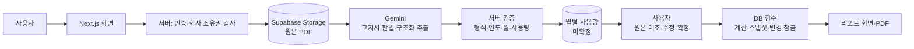

# CarbonReply · 탄소길잡이


**전기요금 고지서 PDF에서 사용량을 추출하고, 사람이 검토·확정한 값으로 Scope 2 배출량을 정리하는 웹 서비스입니다.**

[서비스 열기](https://carbon-reply.vercel.app) · [프로젝트 배경과 회고](미니프로젝트3_김나린.md) · [테스트 안내](AUTOMATED_TESTING.md)

`Next.js` `TypeScript` `Gemini` `Supabase Auth / Database / Storage` `Vitest` `Playwright`

> **AI는 초안을 추출하고, 사용자는 원본을 확인하며, 코드는 계산과 확정을 처리합니다.**
> 전기 사용량에 한정한 Scope 2 간이 추정·정리 도구입니다. 법정 검증이나 공시용 산정서를 대체하지 않습니다.

## 해결하려는 문제

월별 고지서에서 청구월과 전력 사용량을 옮겨 적는 작업에는 다른 연도 자료, 중복 월, 누락·이상 사용량이 섞일 수 있습니다. AI가 숫자를 읽었다는 사실만으로 계산에 사용할 수는 없습니다.

CarbonReply는 **원본 파일 → AI 추출값 → 사용자가 확인한 월별 값 → 확정 리포트**를 나누어 관리합니다. 수정 이력과 확정 당시의 값·배출계수를 남겨 결과를 다시 확인할 수 있도록 했습니다.

## 사용 흐름

1. **로그인·산정 설정** — 회사와 산정연도를 기준으로 프로젝트를 만듭니다.
2. **자료 업로드** — PDF 또는 PDF 묶음 ZIP을 올립니다. ZIP은 최대 12개 PDF를 처리합니다.
3. **AI 추출** — 고지서 여부·청구연월·전력 사용량(kWh)을 구조화된 값으로 읽습니다.
4. **원본 대조·수정** — 원본 PDF와 추출값을 비교하고, 잘못 읽은 값은 수정해 저장합니다.
5. **검토·확정** — 미확정 자료와 유효하지 않은 값을 확인한 뒤 결과를 확정합니다.
6. **리포트 확인** — 월별 사용량·추정 배출량·적용 계수·검증 등급을 보고 PDF로 내려받습니다.

테스트 자료: [정상 고지서 ZIP](public/test-data/CarbonReply-test-data.zip) · [예외 고지서 ZIP](public/test-data/CarbonReply-test-exceptions.zip) · [자료 안내](public/test-data/테스트_안내.md)

## 핵심 설계

| 문제 | 구현 |
| :--- | :--- |
| 금액을 전력 사용량으로 잘못 읽음 | Gemini에 **청구된 kWh**를 추출하도록 요청하고 JSON 스키마와 서버 검사를 적용 |
| 고지서가 아닌 PDF를 업로드 | 문서 판별과 PDF 헤더 검사 후 오류 코드·안내 반환 |
| 다른 연도·중복 청구월 포함 | 프로젝트 산정연도와 대조하고, 같은 월이 이미 있으면 추출값 등록 거부 |
| 추출값의 오류·누락 | AI 결과는 미확정 상태로 저장하고, 원본 대조와 수동 보정 제공 |
| 확정한 보고서의 근거가 바뀜 | 월별 사용량·배출계수를 스냅샷으로 저장하고, 확정 자료 변경을 DB 트리거로 차단 |
| 회사별 자료가 섞임 | 서버에서 회사 소유권을 검사하고, DB에 회사별 접근 정책 적용 |

### 검증 등급과 확정 조건

- **A:** 12개월이 모두 있고, 값 경고가 없는 자료
- **B:** 값 경고는 없지만 일부 달이 빠진 자료
- **C:** 잘못된 값·0 kWh·통계적 이상치 등 검토할 항목이 있는 자료

등급은 자료 검토를 돕는 앱 내부 기준입니다. 제3자 인증 등급이 아닙니다.

현재 확정 조건은 **자료가 하나 이상 있고, 모든 값이 확인되었으며, 유효하지 않은 월·값이 없는 것**입니다. 누락 월이나 확인된 이상치만으로 확정을 막지는 않습니다. 따라서 B·C 등급의 부분 자료도 리포트로 확정할 수 있습니다.

## 처리 구조



### AI와 코드의 역할

| 담당 | 역할 |
| :--- | :--- |
| Gemini `gemini-2.5-flash` | PDF에서 `isElectricityBill`, `billingYear`, `billingMonth`, `usageKwh` 추출 |
| 서버 코드 | 응답·입력 검증, 연도·중복 검사, 회사 소유권 확인 |
| 사용자 | 원본 PDF와 추출값 대조, 월별 사용량 수정·확정 |
| 계산 코드·DB 함수 | 배출계수 선택, 배출량 계산, 리포트 스냅샷 저장·확정 잠금 |

계산은 **사용량(kWh) × 배출계수(kgCO₂e/kWh) ÷ 1,000 = tCO₂e**입니다. 계수의 연도·버전을 리포트에 남깁니다. 해당 연도 계수가 코드에 없으면 저장된 이전 연도 계수를 임시 적용합니다. [계수 선택·계산 코드](lib/emission-factor.ts)

이 프로젝트는 위 순서로 동작하는 AI 문서 처리 워크플로입니다. 모델이 임의로 도구와 실행 경로를 선택하는 구조는 아닙니다.

## 코드 살펴보기

| 위치 | 확인할 내용 |
| :--- | :--- |
| [lib/gemini.ts](lib/gemini.ts) | PDF 전달·구조화 추출·응답 검사 |
| [추출 완료 API](app/api/projects/[id]/uploads/[documentId]/complete/route.ts) | 소유권·파일·연도·사용량·중복 월 검사 |
| [lib/bill-validation.ts](lib/bill-validation.ts) | 누락 월·0 kWh·이상치·등급 판정 |
| [lib/workflow-validation.ts](lib/workflow-validation.ts) | 화면·서버가 공유하는 확정 조건 |
| [app/actions/review.ts](app/actions/review.ts) | 사용량 검토·확정과 DB 함수 호출 |
| [supabase/migrations/](supabase/migrations/) | 확정 스냅샷·DB 변경 잠금 |
| [lib/report-pdf.ts](lib/report-pdf.ts) | 리포트 PDF 생성 |

## 로컬 실행

Node.js·npm과 별도의 Supabase 프로젝트, Gemini API 키가 필요합니다.

```bash
git clone https://github.com/Xnarin/CarbonReply.git
cd CarbonReply
npm ci
```

1. 빈 Supabase 프로젝트에 [기본 스키마](supabase/schema.sql)를 적용합니다.
2. [마이그레이션](supabase/migrations/)의 SQL 파일을 파일명 순서로 적용합니다. 기본 스키마만으로는 확정 스냅샷 기능이 모두 준비되지 않습니다.
3. `.env.example`을 `.env.local`로 복사하고 다음 값을 채웁니다.

```dotenv
NEXT_PUBLIC_SUPABASE_URL=
NEXT_PUBLIC_SUPABASE_PUBLISHABLE_KEY=
SUPABASE_SECRET_KEY=
NEXT_PUBLIC_SITE_URL=http://localhost:3000
GEMINI_API_KEY=
```

`SUPABASE_SECRET_KEY`와 `GEMINI_API_KEY`는 서버에서만 사용합니다. 환경변수 파일은 커밋하지 않습니다.

```bash
npm run dev
```

[http://localhost:3000](http://localhost:3000)에서 확인합니다. `/api/health`가 `{"status":"ok"}`를 반환하면 서버의 기본 DB 연결을 확인할 수 있습니다.

## 테스트

```bash
npm run lint
npm run test
npm run build
```

| 범위 | 저장소의 테스트 |
| :--- | :--- |
| 파일·사용량 검사 | [bill-validation.test.ts](tests/unit/bill-validation.test.ts) |
| 추출 결과와 다음 조치 | [extraction-quality.test.ts](tests/unit/extraction-quality.test.ts) |
| 월별 확정 조건·계수·계산 | [scope2-workflow.test.ts](tests/unit/scope2-workflow.test.ts) |
| 로그인·확정 리포트·PDF·검토 화면 접근 제한 | [completed-report.spec.ts](tests/e2e/completed-report.spec.ts) |

E2E는 별도 테스트 계정과 이미 확정된 12개월 프로젝트를 준비해야 합니다. 필요한 환경변수가 없으면 건너뜁니다. [설정과 실행 방법](AUTOMATED_TESTING.md)

위 테스트는 앱의 검증·계산·확정 흐름을 다룹니다. 실제 고지서에 대한 AI 추출 정확도를 측정한 평가 결과는 아직 정리되어 있지 않습니다.

## 현재 범위와 다음 검증

- 전기 고지서 기반 Scope 2만 다루며 Scope 1·3, 한전·ERP 자동 연동, 다중 사업장·담당자 승인 기능은 포함하지 않습니다.
- 배출계수는 코드에 저장된 목록을 사용합니다. 최신 계수를 자동으로 수집·갱신하지 않습니다.
- 다음 검증은 실제 고지서 표본을 확보해 **청구연월·kWh 정확도, 비고지서 오인식, 수동 보정 비율**을 측정하는 것입니다.
- 누락 월이 있는 리포트를 전체 연간 사용량으로 오해하지 않도록 자료 범위 표시를 계속 점검해야 합니다.

## 문서·디자인 참고

- [프로젝트 배경·기능 범위·회고](미니프로젝트3_김나린.md)
- [테스트·환경 설정](AUTOMATED_TESTING.md)
- [예외 고지서 시나리오](output/pdf/잘못된_고지서_예시/README.md)
- [외부 자료·컴포넌트 출처](THIRD_PARTY_NOTICES.md)
